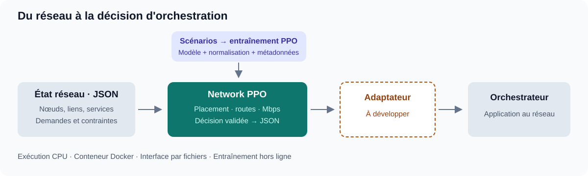
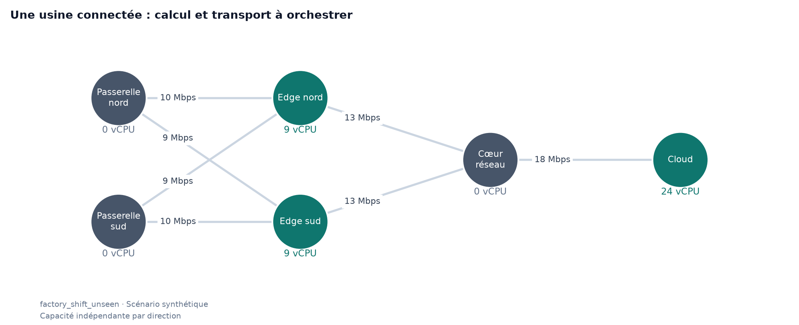
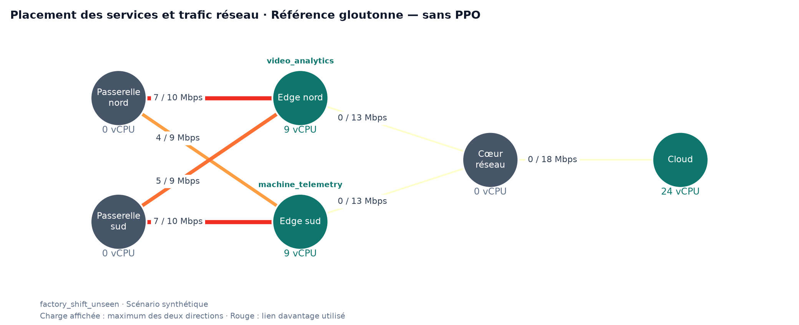

# Network PPO — Un moteur de décision pour l'orchestration réseau

**Décider où exécuter les services, par où acheminer les demandes et quelle bande passante leur allouer.**

Network PPO apprend une politique d'orchestration pour maximiser le trafic servi sous contraintes de calcul, de capacité réseau et de latence. À partir d'un état réseau décrit en JSON, il produit une décision structurée et vérifiée, exploitable par une plateforme d'orchestration existante.

**Python 3.10+ · PPO / Stable-Baselines3 · Docker CPU · Entrées/sorties JSON · Licence MIT**

## Du réseau à la décision



| Votre besoin | Ce que fournit le moteur |
| --- | --- |
| Coordonner calcul et transport | Placement des services, routes des demandes et allocation de Mbps dans une même décision. |
| Respecter les ressources et les budgets de latence | Contrôle des contraintes du modèle avant chaque modification et avant l'export. |
| Évaluer une politique avant son intégration | Entraînement hors ligne, scénario d'évaluation distinct et comparaison à une référence gloutonne. |
| Exécuter dans votre environnement | Scripts autonomes, Dockerfile pour une exécution CPU, modèle sauvegardé et interface par fichiers JSON. |

Le composant est **conteneurisable et intégrable** : entraînez la politique hors ligne, puis réutilisez le checkpoint pour calculer des décisions sur de nouveaux états du même réseau.

## Explorer le démonstrateur industriel

Le démonstrateur représente une usine connectée : deux passerelles, deux nœuds edge, un cœur réseau et un cloud. Les services d'analyse vidéo et de télémétrie partagent les ressources disponibles ; les scénarios font varier les demandes, les capacités et les budgets de latence.



**10 scénarios synthétiques pour entraîner ; 1 scénario tenu à l'écart pour évaluer.** Le notebook permet d'explorer la topologie, le trafic servi et l'utilisation des ressources.

**Exemple d'usage : adapter l'orchestration à une variation des demandes.** Lorsque les besoins des caméras ou des capteurs changent, fournissez le nouvel état réseau et lancez une évaluation avec le modèle entraîné. Vous obtenez un plan de placement, de routage et d'allocation de bande passante, que votre plateforme peut examiner puis appliquer via son adaptateur.



Cette vue montre une décision calculée par la **référence gloutonne, sans PPO** : services placés sur les nœuds edge et trafic alloué aux liens. Chaque lien affiche la charge maximale de ses deux directions rapportée à sa capacité. Les comparaisons d'efficacité et les résultats PPO sont accessibles dans le notebook.

## Essayer en trois commandes

Avec **Python 3.10+**, depuis la racine du repo :

```bash
python -m pip install -e .
python train.py
python eval.py
```

L'entraînement sauvegarde le modèle, les statistiques de normalisation et les métadonnées dans `outputs/ppo_factory/`. L'évaluation produit **`outputs/decision.json`** : placements, routes, Mbps alloués, latences, charges CPU et réseau, fraction du trafic servi et écart à la référence gloutonne.

**Exécuter avec Docker** — commandes Bash, avec conservation du modèle et des décisions :

```bash
docker build -t network-ppo .
docker run --rm -v "$(pwd)/outputs:/app/outputs" network-ppo python train.py
docker run --rm -v "$(pwd)/outputs:/app/outputs" network-ppo python eval.py
```

**Explorer les graphiques dans Jupyter** :

```bash
python -m pip install -e '.[notebook]'
python -m jupyterlab notebook/network_and_efficiency.ipynb
```

Le notebook fonctionne sans modèle entraîné pour explorer le réseau et la référence. Lorsqu'un checkpoint est disponible, il peut lancer une évaluation PPO et afficher ses résultats. Les figures du README sont régénérées par le notebook.

## Intégrer à votre propre réseau

1. **Décrire votre réseau et vos demandes** en JSON : ressources CPU, liens, services, débits minimum/maximum et budgets de latence.
2. **Entraîner sur votre périmètre** : fournir 10 scénarios compatibles d'une même topologie, puis conserver le checkpoint et ses métadonnées.
3. **Évaluer de nouveaux états** de ce réseau et mesurer le trafic servi, le respect des contraintes et l'écart à la référence.
4. **Raccorder le moteur à votre orchestrateur** : construire les adaptateurs d'entrée et d'application, puis valider le fonctionnement sur votre infrastructure.

## Périmètre et documentation

La V1 conserve la topologie, les identifiants ordonnés et l'inventaire des services/demandes entre entraînement et évaluation ; les capacités, demandes et latences peuvent varier. Un nouveau réseau nécessite un nouvel entraînement.

Le démonstrateur utilise des données synthétiques et un modèle de contraintes simplifié. PPO cherche à améliorer une initialisation faisable, sans garantie d'optimalité ni de supériorité sur la référence. Les performances et le comportement en production sont à valider sur vos données.

- [Guide technique](docs/technical-guide.md) : format JSON, options, conventions réseau, Docker et tests.
- [Notebook réseau et efficacité](notebook/network_and_efficiency.ipynb) : figures reproductibles et comparaison à la référence.
- [Scénario d'évaluation](instances/eval/factory_shift_unseen.json) · [Licence MIT](LICENSE).
