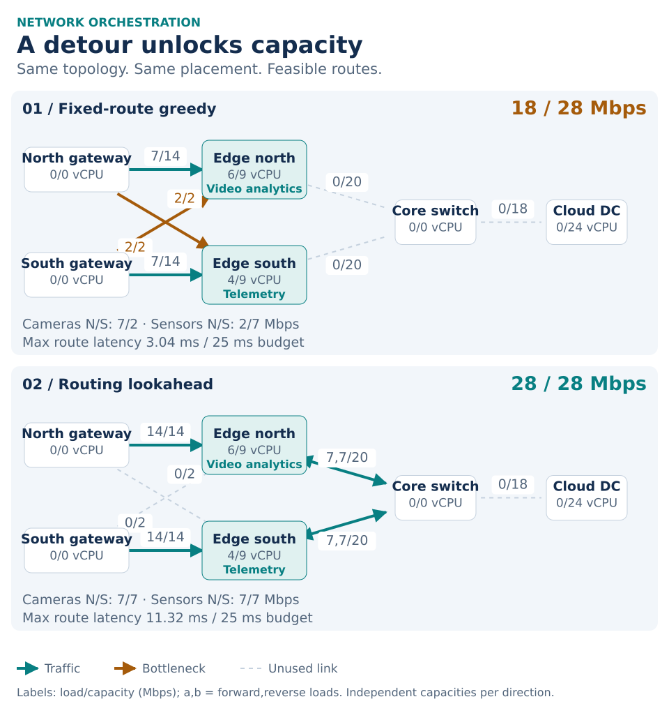
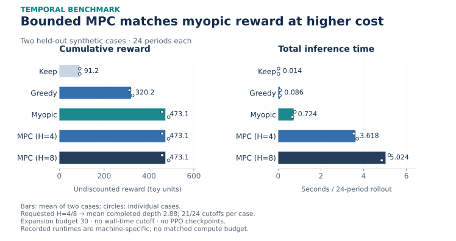
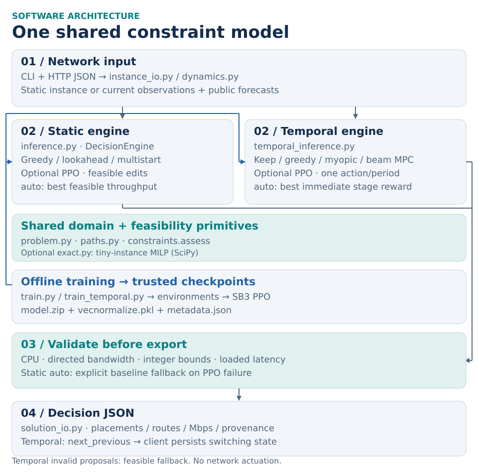

# MEC Deployable

**Place services, route traffic, and allocate bandwidth under explicit edge-network constraints.**

[](https://github.com/OrsoF/mec-deployable/actions/workflows/ci.yml)

An auditable research and engineering demonstrator combining optimization baselines, causal temporal planning, and optional reinforcement learning. Decisions respect vCPU budgets, independent directed-link capacities, integer traffic bounds, and load-dependent latency in a deterministic network model.

<picture>
  <source media="(max-width: 600px)" srcset="docs/assets/orchestration-mobile.svg">
  
</picture>

*Synthetic held-out instance, computed from the shipped solvers. Arrows show aggregate directed traffic; labels show load/capacity in Mbps. [Instance](instances/eval/bottleneck_unseen.json) · [Figure sources and provenance](docs/figures/README.md).*

The engineering question: **when a network is congested, which placement, path, and allocation should be committed—and how can that decision be checked?** This project makes the model, competing strategies, evaluation budget, and integration contract inspectable. It uses synthetic data, bundles no trained policy, and applies no changes to a real network.

| Capability | Implementation |
| --- | --- |
| Constrained decisions | Shared problem types, deterministic candidate paths, independent feasibility checks |
| Optimization and RL | Fixed-route greedy, routing lookahead, multistart, optional tiny-instance MILP and SB3 PPO |
| Temporal control | Dynamic traffic/capacity, switching costs, public forecasts, bounded causal beam MPC |
| Integration and evaluation | Validated JSON, CLI and HTTP adapters, CSV benchmarks, tests, CI, Docker packaging |

## Why routing matters

Each gateway requests camera and sensor traffic. Video analytics consumes **6 vCPU** at edge north; telemetry consumes **4 vCPU** at edge south, each with **9 vCPU** available. Four demands request up to **7 Mbps** each. Direct cross-gateway links carry only **2 Mbps per direction**.

Greedy fills the fixed routes and stalls at 18 Mbps. Routing lookahead tests a feasible reroute, then greedily increases bandwidth. The two cross-gateway demands take the local edge → core → opposite edge detour, reaching 28 Mbps. Maximum route latency rises from **3.04 to 11.32 ms**, within the **25 ms** budget. Placement stays fixed; this example demonstrates routing and allocation, rather than a migration benefit.

## Evidence and its limits

The static held-out case is reproducible with `benchmark.py` and covered by a [regression test](tests/test_bottleneck.py).

| Static method | Served traffic | Feasible | Interpretation |
| --- | ---: | :---: | --- |
| Fixed-route greedy | 18 / 28 Mbps | Yes | Capacity bottleneck on fixed routes |
| Routing lookahead + greedy uplift | 28 / 28 Mbps | Yes | Reaches the demand upper bound |
| Multistart routing lookahead | 28 / 28 Mbps | Yes | Same upper bound |

Reaching the sum of all demand ceilings proves optimality **on this instance only**. The ten training cases and one held-out case vary parameters on one ordered topology; they do not establish general optimality or generalization to new topologies.

<picture>
  <source media="(max-width: 600px)" srcset="docs/assets/temporal-comparison-mobile.svg">
  
</picture>

*Recorded [CSV](docs/temporal_benchmark_two_cases.csv) and [summary](docs/temporal_benchmark_two_cases_summary.json): two held-out synthetic scenarios, 24 periods each. Reward sums served traffic minus migration, rerouting, and active-node penalties in toy utility units; it is not measured energy or revenue.*

**No MPC advantage was observed in this two-case run.** With five candidates, beam width two, an expansion budget of 30 and no wall-time cutoff, MPC4/MPC8 completed only **2.88 steps on average**, with **21/24 planning cutoffs per case**. These are beam approximations, not certified MPC optima. The plot retains the original machine-specific wall times; algorithmic compute budgets were not matched. Two cases cannot support broad statistical conclusions.

**PPO performance remains unestablished.** The [local CI audit](docs/ci-verification.md) records a static 512-step smoke policy serving **4/28 Mbps**. That verifies training/checkpoint plumbing, not learning quality. No independent multi-seed PPO-versus-strong-baseline result is supplied, and the temporal comparison contains no PPO checkpoints. Hybrid static PPO shares a reroute-and-uplift primitive with lookahead, which must be considered in fair comparisons.

## Architecture and decision pipeline

<picture>
  <source media="(max-width: 600px)" srcset="docs/assets/architecture-mobile.svg">
  
</picture>

Both engines reuse [`Problem` / `Solution`](src/network_ppo/problem.py), [`PathCatalog`](src/network_ppo/paths.py), and [`assess`](src/network_ppo/constraints.py). The checker enforces CPU, directed bandwidth, integer bounds, and additive latency with a linear load term. Feasibility is a guarantee **within this model**, not an operational SLA. Bounded seed-search failure does not prove a problem infeasible.

Static `auto` compares lookahead and compatible PPO candidates by served Mbps, reports the selected method, and records an explicit baseline fallback if PPO fails; static `ppo` has no silent algorithm fallback. Temporal `auto` compares MPC and PPO by **immediate stage reward**, not trajectory return. Invalid temporal PPO proposals use a recorded feasible fallback. Checkpoint metadata fixes topology and action semantics; observation normalization is frozen for inference.

Static PPO learns sequential edits on a frozen instance. Temporal PPO makes one placement/routing choice per physical period, followed by feasible bandwidth allocation. Online planning reads current observations and published forecasts, never future realized traffic or capacity. Clients must persist and resend `next_previous` to account for switching costs. [Full temporal model and contract](docs/temporal-design.md).

## Quick start

Python **3.10+**. The baseline engine needs NumPy and NetworkX; the test extra adds pytest and SciPy. Run from the repository root:

```bash
python -m pip install -e '.[test]'
python deploy.py --strategy greedy --output outputs/greedy.json
python deploy.py --strategy lookahead --output outputs/decision.json
python benchmark.py --instances instances/eval --output outputs/benchmark
python -m pytest -q
```

The two deployment commands report **18/28** and **28/28 Mbps**, respectively, with `feasible=True`. The output contains service placements, directed routes, allocated Mbps, latencies, loads, method provenance, and diagnostics. Benchmark outputs are `results.csv` and `summary.json`.

One causal temporal decision:

```bash
python temporal_deploy.py --strategy mpc --horizon 4 --snapshot instances/temporal/online_example.json --output outputs/next_temporal_decision.json
```

The online adapter defaults to a 400 ms planning cutoff in addition to its bounded expansion budget; inspect `planning_horizon_reached` and `planning_budget_exhausted`.

### HTTP and container integration

```bash
python serve.py --host 127.0.0.1 --port 8080 --strategy lookahead
```

In another terminal (`curl.exe` on Windows PowerShell):

```bash
curl -s http://127.0.0.1:8080/ready
curl -s -X POST http://127.0.0.1:8080/decide -H 'Content-Type: application/json' --data-binary @instances/eval/bottleneck_unseen.json
```

The reference adapters validate inputs, limit request bodies to 1 MiB, and serialize inference access. They provide **no authentication, TLS, rate limiting, persistence, or operational monitoring**. Use a configured trusted gateway for deployment. Only load trusted local SB3 checkpoints: policy and normalization artifacts use pickle internally.

```bash
docker build -t mec-deployable .
docker run --rm -p 127.0.0.1:8080:8080 mec-deployable
```

The default image serves the baseline API without RL dependencies. `INSTALL_RL=true` enables PPO dependencies; see the [deployment guide](docs/technical-guide.md#deployment) for checkpoint mounts. Docker build/runtime has not been verified in the recorded local audit. The [CI workflow](.github/workflows/ci.yml) covers core tests, CLI benchmarks, and optional static/temporal PPO smoke runs; it has no Docker job.

## Reproduce and explore

| Resource | Contents |
| --- | --- |
| [Technical guide](docs/technical-guide.md) | Model equations, algorithms, static training/evaluation, JSON contract, deployment |
| [Temporal design](docs/temporal-design.md) | Causal information boundary, reward, planning budgets, temporal PPO and evaluation protocol |
| [Figure guide](docs/figures/README.md) | Deterministic regeneration, source hashes, recorded experiment protocol, legacy assets |
| [CI audit](docs/ci-verification.md) · [earlier verification](docs/verification.md) | Executed checks, smoke outcomes, environment and coverage limits |
| [Multi-seed training](scripts/train_multiseed.py) · [static evaluation](scripts/benchmark_multiseed.py) | Independent training seeds and best-of-episode evaluation budgets |

Optional PPO: install `'.[rl,test]'`, then follow the training/evaluation commands in the guides. No policy is bundled. Static and temporal checkpoints are separate; new ordered topologies or service/demand identities require retraining. Multiple stochastic episodes are a best-of-budget search, not single-pass inference.

The model omits packet loss, probabilistic SLAs, traffic uncertainty, migration downtime, and real deployment economics. Temporal forecasts are synthetic exogenous signals, not a learned forecasting system. Future work includes topology generalization, calibrated uncertainty, independently trained policies, and comparisons under matched computational budgets.

The [original notebook](notebook/network_and_efficiency.ipynb), its [legacy figures](docs/figures/README.md#retained-legacy-visuals), and their attribution/provenance remain available. They describe the original factory scenarios, not the congested benchmark or PPO performance.

Licensed under [MIT](LICENSE).
