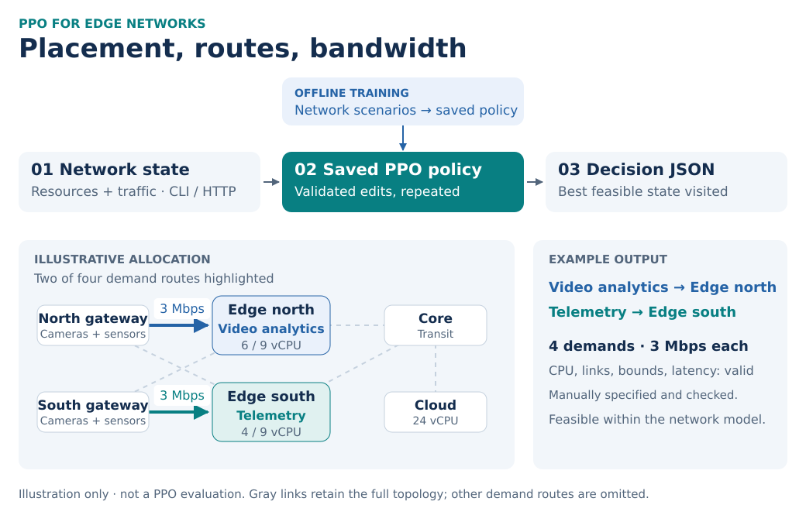

# MEC Deployable

**PPO-based service placement and routing for on-demand edge-network decisions.**

[](https://github.com/OrsoF/mec-deployable/actions/workflows/ci.yml)

Where should a service run, and how should traffic reach it? Edge nodes have limited computing resources, network links have limited bandwidth, and applications have latency requirements. **MEC Deployable uses Proximal Policy Optimization (PPO)** to learn how to place services, route traffic, and allocate bandwidth within these constraints.

<picture>
  <source media="(max-width: 600px)" srcset="docs/assets/ppo-placement-mobile.svg">
  
</picture>

*Example topology from the repository. Link labels show capacity in Mbps per direction.*

## How it works

1. **Train offline.** PPO learns from network scenarios in a Gymnasium environment.
2. **Generate a decision.** A saved policy guides placement, routing, and bandwidth edits from the current network state.
3. **Validate and export.** Check CPU capacity, directed bandwidth, integer traffic bounds, and load-dependent latency; return a feasible decision as JSON.

Train offline, then reuse the saved policy through the CLI or HTTP API. Static inference runs a sequence of validated edits and returns the best feasible state visited.

## Decision latency

A local CPU measurement gave **42.6 ms median** and **59.4 ms p95** for a complete validated PPO decision: one 96-edit episode, with the model already loaded. This used 100 requests on one synthetic instance and a 512-step smoke checkpoint. It measures execution speed; placement quality requires a separate evaluation. [Protocol, hardware, results, and reproduction](docs/ppo-latency.md).

## Train, evaluate, deploy

Python **3.10+**, from the repository root. Install the PPO dependencies, train a policy, then evaluate it on the held-out instance:

```bash
python -m pip install -e '.[rl]'
python train.py --timesteps 100000 --output outputs/ppo_bottleneck
python eval.py --checkpoint outputs/ppo_bottleneck --output outputs/ppo_decision.json
```

Serve the trained policy in Docker:

```bash
docker build --build-arg INSTALL_RL=true -t mec-deployable .
docker run --rm -p 127.0.0.1:8080:8080 --mount "type=bind,source=$PWD/outputs,target=/app/outputs,readonly" mec-deployable python serve.py --host 0.0.0.0 --strategy ppo --checkpoint outputs/ppo_bottleneck
```

`POST /decide` accepts a network instance and returns placements, routes, allocated Mbps, and validation diagnostics. [Input format and deployment details](docs/technical-guide.md#input-and-output-contract).

## Scope and documentation

A research and engineering demonstrator using synthetic scenarios. No trained model is bundled and no network changes are applied. Policies require the same ordered topology and service/demand identities. Feasibility applies to the simplified network model. Load only trusted checkpoints; the HTTP adapter needs a gateway providing authentication and TLS. Docker runtime remains unverified locally.

[Technical guide](docs/technical-guide.md) · [Temporal control](docs/temporal-design.md) · [Tests and CI](docs/ci-verification.md) · [Figure sources](docs/figures/README.md) · [MIT license](LICENSE)

## Related Projects

- [mec-placement-benchmarks](https://github.com/OrsoF/mec-placement-benchmarks) — Benchmarking optimization and learning methods for constrained edge-network orchestration.
- [mdpforge](https://github.com/OrsoF/mdpforge) — A Python framework for finite MDP modeling, solving, and benchmarking.

More about my research, publications, and software projects: [orsof.github.io](https://orsof.github.io/).
